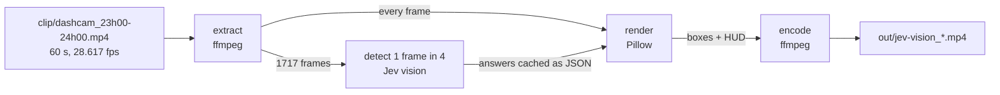
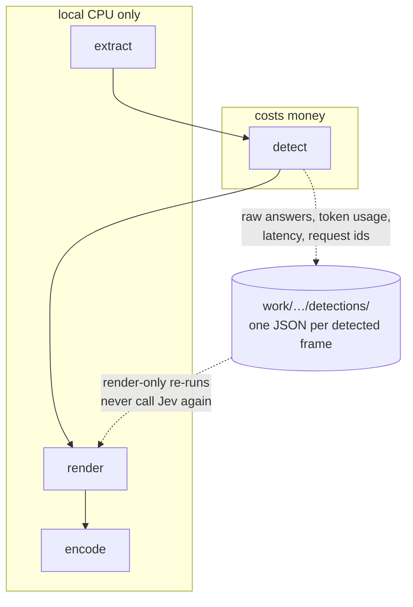
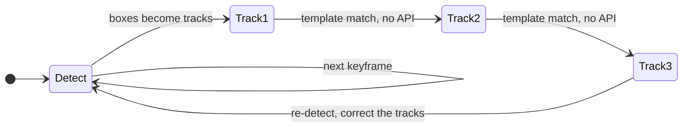
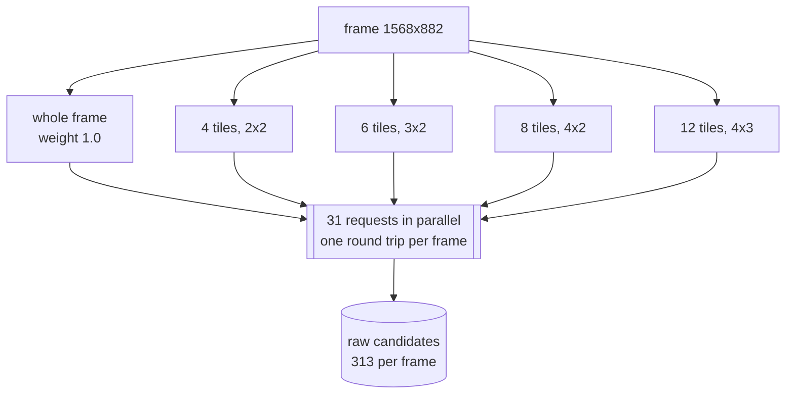
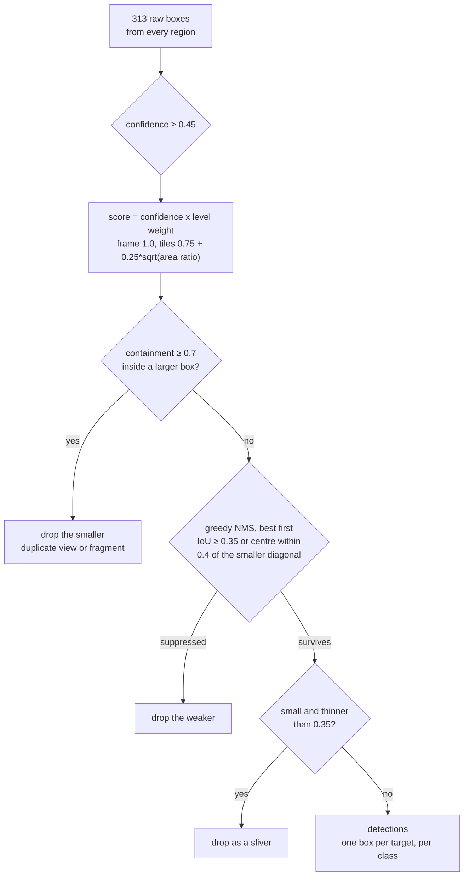

# jev-self-driving-vision-demo

Cars, motorcycles and buses boxed in a dashcam video by TypeSafe's Jev, drawn
back onto the video with a live readout of what the run costs.

Jev looks at one frame in four. The frames between are followed by a local
template tracker, which makes no API call and costs nothing.

Built from the TypeSafe docs: [images](https://docs.typesafe.ai/images),
[Box primitive](https://docs.typesafe.ai/primitives/box),
[Python SDK](https://docs.typesafe.ai/sdk/python).



## What the demo shows

A dashcam minute from Jakarta, 23:00–24:00, processed at the source's own frame
rate. Three classes: car, motorcycle, bus.

The video's top-right corner reports, live:

| HUD line | Meaning |
| - | - |
| `JEV LATENCY AVG` | Running average of Jev's response time over the frames it answered |
| `TOTAL COST` | Cumulative cost, accumulated frame by frame |
| `DETECTIONS` | Cumulative accepted detections |

Solid boxes come from a Jev answer for that frame. Dashed boxes, labelled with a
`~`, were tracked locally between answers.

Measured on the shipped clip:

| | value |
| - | - |
| Frames | 1717 at 28.617 fps (the clip's own rate) |
| Jev requests | 13,330 (31 per detected frame) |
| Raw boxes from Jev | 134,580 (313 per detected frame) |
| Detections after fusion | 13,544 (7.9 per frame); fusion removes 90% of raw boxes |
| Jev latency | mean 642 ms per detected frame |
| Cost | $1.0223 for the minute |
| Runtime | ~5 min with `--workers 4 --tile-workers 16` |

## Quick start

```sh
python3 -m venv .venv
.venv/bin/pip install -r requirements.txt
echo 'TYPESAFE_API_KEY=...' > .env        # key from https://console.typesafe.ai
.venv/bin/python jev_vision.py            # runs the shipped clip end to end
```

The output lands in `out/jev-vision_dashcam_<date>_<time>.mp4`. Add
`--workers 16 --tile-workers 32` to go faster, or `--limit 120` to try a few
seconds first (about $0.07).

## How it works

### 1. Four stages, so the paid part runs once



* **extract** reads the source frame rate with ffprobe (`r_frame_rate`, here
  `29962/1047`) and cuts frames at it, so the output cadence matches the input
  rather than approximating it. The requested window is checked against the real
  duration of the source first, so a bad timestamp fails in seconds.
* **detect** is the only stage that spends money. One JSON per detected frame
  keeps Jev's raw answers, token usage, request ids and latency.
* **render** applies every threshold and the fusion policy to the cached
  answers. Changing colours, thresholds, NMS or the HUD costs nothing.
* **encode** joins the frames into H.264 at the source frame rate.

Caches are namespaced by frame rate, tiling layout and question set
(`work/v6-fps29962x1047-grids4-6-8-12-ov0-max10-detect4/`). Frame 900 sits at a
different timestamp at 30 fps than at 28.617 fps, and a different question set
gives different answers, so each combination gets its own directory instead of
silently mixing records.

### 2. Detect one frame, track the next three



Jev answers one frame in four (`--detect-every 4`). The frames between are
followed by template matching in numpy. The previous box becomes a template, a
coarse pass on a downscaled grid finds it, a full-resolution pass lands it
within a pixel, and the match quality (normalized cross-correlation) decides
whether the track survives. A track that loses its object is dropped rather than
left sitting on empty road.

A quarter of the frames reach the API, and the boxes move with the object
instead of twitching. A fresh detection is an independent estimate, so boxes
jitter even for a car driving straight; tracked frames follow the pixels. Both
damping factors were tuned by measurement:

| policy | car box movement, frame to frame |
| - | - |
| detect every frame | 13.0 px |
| `--track-smooth 0.6 --detect-blend 0.75` | 6.0 px, snapping 18.5 px on detect frames |
| `--track-smooth 0.6 --detect-blend 0.35` (default) | 3.3 px, snapping 8.4 px |

### 3. Ask four tilings at once



A Box question returns one box, so each region is asked for up to 10 objects per
class ("the 1st, 2nd, … 10th most prominent car"), and Jev answers those
questions in parallel. Each region also carries a presence Noul per class, which
gates its boxes.

An object that sits on a boundary in one grid is whole in another, because 4, 6,
8 and 12 divide the frame in different places. No overlap padding is needed.
Tiles stay above 256 px per side and 78,400 px in area, the floor the images API
accepts.

### 4. Overlay everything, then reduce like a detector



Four passes, all applied while rendering:

1. **Score.** `confidence × level weight`, where the whole frame weighs 1.0 and a
   tile weighs less (`0.75 + 0.25 × √(tile area / frame area)`). Two answers for
   one object then sort by how much context each had.
2. **Containment.** A smaller box sitting at least 0.7 inside a larger one is a
   duplicate view or a fragment, and goes. A clearly stronger inner box survives
   (score > 1.15× the outer).
3. **NMS.** Greedy non-maximum suppression, best first, suppressing on IoU ≥ 0.35
   or centre distance within 0.4 of the smaller box's diagonal. Face detectors
   use the same centre test, because loose boxes overlap little while sitting on
   the same face. With IoU alone, Jev's boxes left the same car in two boxes.
4. **Sliver guard.** Small boxes thinner than 0.35 are rejected, the way detectors
   constrain anchors by aspect ratio. A sliver overlaps nothing, so containment
   and NMS cannot catch it.

## Cost

Cost is accumulated from Jev's own responses, not estimated:

```
cost += response.usage.input_tokens * $42 / 1e9      # output tokens are free
```

$42 per billion input tokens is TypeSafe's published rate. Every response also
carries `usage.output_tokens` and a `request_id`, both kept in the cache.
Tracked frames make no API call, so 3 of every 4 frames cost $0.00.

## Options

```
--start 0:00            start timestamp (MM:SS, or HH:MM:SS, or plain seconds)
--end 1:00              end timestamp, same shapes
--fps source            'source' matches the video's own rate; or 30; or 29962/1047
--limit 120             process only the first N frames
--workers 4             frames detected in parallel; 1 = strictly one at a time
--tile-workers 16       width of the request fan-out (frame + all tiles + all grids)
--detect-every 4        detect on 1 frame, track across the next 3; 1 = detect every frame
--track-threshold 0.5   minimum template-match quality to keep a track alive
--track-search 48       pixels to search around a tracked box each frame
--track-smooth 0.6      how much of a tracked move to apply; lower is steadier
--detect-blend 0.35     how much a fresh detection moves an existing box
--model jev-1.14.0      Box questions require Jev 1.14
--tile-grids 4,6,8,12   tile counts to cut, all asked in parallel ('off' = frame only)
--tile-overlap 0        fraction shared with the neighbouring tile
--max-per-tile 10       most objects asked for per class per region
--nms-iou 0.35          same-class overlap above this: the weaker box goes
--nms-center 0.4        centres closer than this, in smaller-box diagonals, are one
--containment 0.7       a smaller box this far inside a larger one is dropped
--min-ratio 0.35        small boxes thinner than this are rejected as slivers
--presence-threshold .5 minimum Noul probability for a class to count as present
--box-threshold 0.45    minimum Box confidence to keep a detection
--render-only           re-render from the cache without calling the API
--keep-render           keep the temporary rendered frames
--keep-frames           keep the extracted frames
--label dashcam         name used in the default output filename
--video clip/…mp4       source video
```

Thresholds, fusion, tiling and the HUD are applied while rendering, so cached
answers can be retuned for free:

```sh
.venv/bin/python jev_vision.py --render-only --nms-iou 0.3 --box-threshold 0.5
```

## Repository layout

```
jev_vision.py                 the whole pipeline
clip/dashcam_23h00-24h00.mp4  the one-minute source clip
out/jev-vision_*.mp4          the latest rendered result
requirements.txt              typesafe-sdk[pil], python-dotenv, numpy
.env                          your API key (not committed)
work/                         caches and scratch frames (not committed)
```

## Using a longer recording

The clip is a 60-second cut of a 55-minute dashcam recording. To run against the
original (or any other video), point the tool at it and give the window in the
video's own timeline:

```sh
.venv/bin/python jev_vision.py \
  --video /path/to/full-dashcam.mp4 --start 23:00 --end 24:00 --workers 16 --tile-workers 32
```

To re-cut the clip from a longer recording:

```sh
ffmpeg -ss 23:00 -i full-dashcam.mp4 -t 60 -c:v libx264 -crf 22 -pix_fmt yuv420p \
       -movflags +faststart clip/dashcam_23h00-24h00.mp4
```

## Requirements and limits

* TypeSafe ships images and Box questions as "Danger Zone" features, off by
  default: every request carrying an image sends
  `TypeSafe-Danger-Zone-Images: true`. Accuracy changes as the models change, so
  tune the thresholds on your own footage. See
  [docs.typesafe.ai/images](https://docs.typesafe.ai/images).
* Images must be 256–1568 px per side, so 1920×1080 frames are sent as 1568×882
  and each tile at its own native size.
* The output has no audio track; the source clip is video-only.
* Disk: ~1.5 GB peak for a full run, ~30 MB kept (the detection cache). RAM
  stays around 200 MB at `--workers 1`, about 1 GB at `--workers 32`.
* numpy is used by the tracker only, never by the API calls.

## Caveats

* TypeSafe labels the Box primitive "dreamer-ready" and it shows. Boxes are
  loose, and false positives turn up: an out-of-focus object at the frame edge, a
  rider counted twice in dense traffic. Fusion removes 90% of raw boxes; the rest
  is what the model saw.
* Detecting every frame costs about 4× more ($4.07 for this minute), because each
  frame would pay for all 31 regions.
* The figures above were measured on the shipped clip with `jev-1.14.0`.
  Re-running produces new cost and latency numbers, and the answers themselves
  can shift when Jev's weights change.
