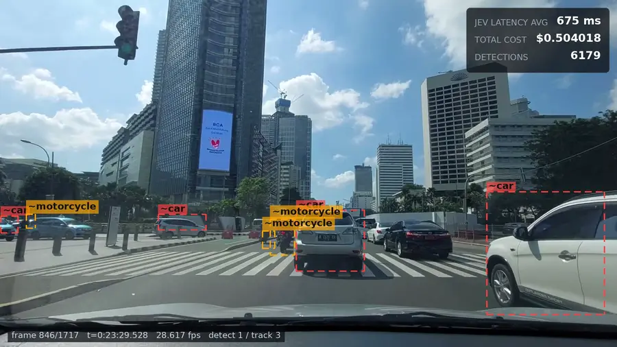
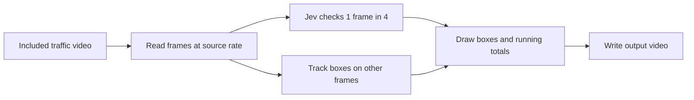
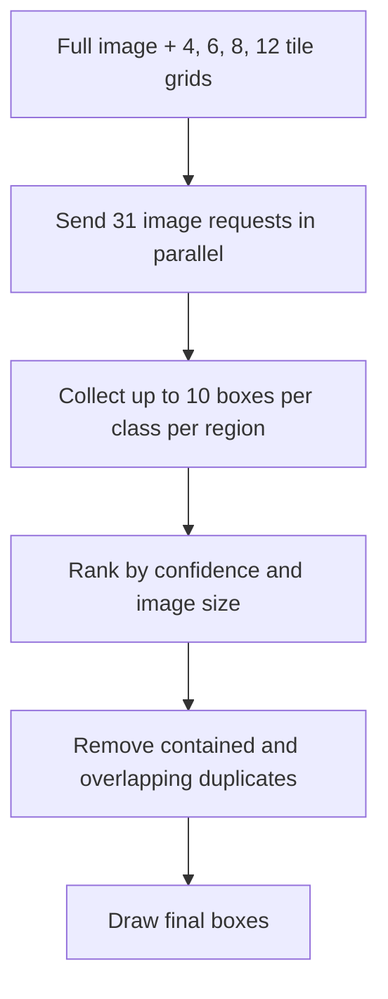

# Jev Vision for Self driving

[](out/jev-vision-2300-2400_2026-10-15_23-18-12.mp4)

A video of traffic in Jakarta. Jev finds cars, motorcycles and buses; the app
draws boxes around them and shows latency, cost and detection count. Click the
preview to open the full one-minute video.

## Run it

The input video is included in `clip/`. You need Python 3.11 or later, ffmpeg,
and a TypeSafe API key.

```sh
python3 -m venv .venv
.venv/bin/pip install -r requirements.txt
cp .env.sample .env      # add your key from https://console.typesafe.ai
.venv/bin/python jev_vision.py
```

The app writes a timestamped video to `out/`. To try about two seconds first:

```sh
.venv/bin/python jev_vision.py --limit 57
```

## How it works



Jev checks one frame in four. A local image tracker follows the boxes in the
other frames, reducing API cost and box jitter. Tracked boxes are dashed; Jev's
boxes are solid.

For each frame Jev checks, the app sends the full image and 30 tiles: grids of
4, 6, 8 and 12 tiles, all at once. Each region asks for up to 10 cars, motorcycles
and buses. This finds objects that are too small or distant in the full image.

The tile views can return several boxes for the same object. The app scores the
boxes, removes boxes inside larger boxes, then uses overlap and box-center
distance to suppress duplicates. It also drops very thin, small boxes. These
rules run locally, so they can be changed without another Jev call.



The stages are separate. `work/` stores Jev's answers, token counts and request
times as JSON. `--render-only` reuses that cache and makes no Jev calls.

## Results on the one-minute video

| Measure | Result |
|---|---:|
| Frames | 1,717 at 28.617 fps |
| Jev requests | 13,330 |
| Boxes before duplicate removal | 134,580 |
| Detections after filtering | 13,544 |
| Average Jev latency | 642 ms per checked frame |
| Jev API cost | $1.0223 |
| Runtime | About 5 minutes with 4 frame workers and 16 tile workers |

The video HUD shows a running average of Jev latency, total API cost, and total
detections. Cost uses Jev's reported input-token count at TypeSafe's published
rate of $42 per billion tokens; output tokens are free. Results and cost can vary
between runs.

## Useful options

```sh
--limit 57                 process about two seconds
--workers 4                frames processed concurrently
--tile-workers 16          tile requests sent concurrently
--detect-every 4           detect once, track the next three frames
--tile-grids 4,6,8,12      tile layouts to use
--max-per-tile 10          maximum objects of each class per region
--render-only              use cached Jev answers; no API calls
--video path/to/video.mp4  use another input video
--start 23:00 --end 24:00  choose a section of a longer video
```

## Files

```text
clip/             included one-minute input video
preview/          animated README preview
out/              latest rendered video
self_driving/     detection, tracking, video and rendering code
work/             local frame and answer cache; not committed
.env.sample       API key template; copy to .env
```

Images and Jev's Box questions are preview features. Boxes can be loose or
incorrect, so review the results before relying on them. The input has no audio,
so the output has no audio either.
